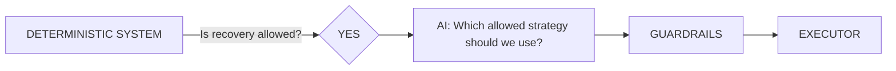

# AI Revenue Recovery

### Turn failed payments into recoverable revenue.

A bounded AI recovery agent that detects failed payments, decides whether recovery is safe, chooses a controlled recovery strategy, executes recovery through Razorpay Payment Links, and verifies the outcome through webhooks.

[](https://nextjs.org/)
[](https://www.typescriptlang.org/)
[](https://www.sqlite.org/)
[](https://vitest.dev/)


Every failed payment is not lost revenue. Sometimes it is simply revenue that needs the right next action. **AI Revenue Recovery** finds those moments, applies deterministic safety rules, lets a bounded AI agent choose the recovery strategy, and verifies whether the money was actually recovered.

---

## Why This Is Different

Most payment-retry systems ask:
> "Can we retry the payment?"

This system asks:
> "Why did it fail, is recovery safe, what is the best allowed next action, and did we actually recover the money?"

- **AI for decision-making** without handing over raw payment keys.
- **Deterministic controls for safety** ensuring no rule-breaking or runaway loops.
- **Webhook verification for truth** ensuring revenue is only marked recovered when the bank says so.
- **Auditability for trust** providing an immutable trail of what happened and why.

---

## How It Works

```mermaid
flowchart TD
    A[PAYMENT FAILED] --> B[CLASSIFY]
    B --> C[CHECK POLICY]
    C --> D[AI CHOOSES STRATEGY]
    D --> E[GUARDRAILS]
    E --> F[RECOVERY ACTION]
    F --> G[VERIFY WEBHOOK]
    G --> H[RECOVERED REVENUE]

    style A fill:#3f1a1a,stroke:#ff6b6b
    style D fill:#1a2a4f,stroke:#2e78f0
    style H fill:#1a3f1a,stroke:#4caf50
```



1. **PAYMENT FAILED**: Razorpay webhook triggers the start of a potential recovery case.
2. **CLASSIFY**: The system maps the raw Razorpay failure code to an internal deterministic taxonomy.
3. **CHECK POLICY**: Hardcoded business rules decide if this specific failure type is eligible for recovery.
4. **AI CHOOSES STRATEGY**: A structured Gemini AI call decides the best approach and generates an explanation.
5. **GUARDRAILS**: The system validates the AI's choice against strict boundaries.
6. **RECOVERY ACTION**: A unique, tracked Razorpay Payment Link is generated and dispatched.
7. **VERIFY WEBHOOK**: The system waits for an asynchronous `payment_link.paid` webhook for the absolute truth.
8. **RECOVERED REVENUE**: Only upon verified payment is the case marked closed and the revenue counted.

---

## The AI Is Bounded By Design

The AI does NOT directly execute payments, mutate database state, bypass policy, override guardrails, or decide eligibility on its own.

The deterministic system controls:
- Failure classification & Eligibility
- State transitions & Idempotency
- Execution safety

The AI only chooses from an allowed recovery strategy set and returns structured decision data.



---

## Architecture

```text
Next.js
|
+-- Presentation
|   +-- Home & Login
|   +-- Command Center
|   +-- Recovery Queue & Transaction Detail
|   +-- Analytics & Audit
|
+-- Operations APIs
|
+-- Domain
|   +-- Classification & Policy
|   +-- State Machine
|
+-- AI Decision Layer
|
+-- Recovery Executor
|
+-- Razorpay Integration
|
+-- SQLite (Persistence)
|
+-- Audit / Metrics
```

---

## See the Product

### Command Center
The operational control room for monitoring failed payments, recovery opportunities, agent decisions, and recovered revenue.


### Recovery Queue
A transaction-level view of cases moving through the recovery pipeline.


### Transaction Intelligence
See exactly why a payment failed, why recovery was allowed, what the AI decided, and whether revenue was actually recovered.


### Auditability
Every important action is traceable.


### Recovery Analytics
See recovered revenue and recovery performance.


---

## Safe Demo Mode

DEMO mode uses a Fake AI provider, a Fake Razorpay client, SQLite, deterministic synthetic failures, and synthetic `payment_link.paid` events.

**There are no customer payments, no unnecessary external API calls, and the demo behavior is strictly deterministic.**

When you run a DEMO Batch, the system processes exactly 10 cases:
- 7 are eligible
- 7 receive AI decisions
- 5 are recovered successfully (revenue generated)
- The rest are safely escalated or marked unrecoverable.

---

## Try the Dashboard

**Demo credentials only:**
- **Email:** `demo@recovery.local`
- **Password:** `demo123`

*(Note: This authentication layer is intentionally lightweight for the hackathon demo and is NOT production identity management.)*

---

## Run Locally

```bash
# 1. Clone the repository
git clone https://github.com/Trunal2005/ai-revenue-recovery.git
cd ai-revenue-recovery

# 2. Install dependencies
npm install

# 3. Setup environment variables
cp .env.example .env
# (Populate with any required keys if switching out of DEMO mode)

# 4. Initialize Database
npm run migrate

# 5. Start Application
npm run dev
```

Open `http://localhost:3000`.
1. Open Home
2. Sign in
3. Open Command Center
4. Run Demo Batch
5. Explore the Queue and Analytics.

---

## How Razorpay Fits In

`payment.failed` → recovery case → Payment Link creation → `payment_link.paid` → verified recovery

Creating a Payment Link does NOT count as recovered revenue. Revenue becomes recovered only after the verified `payment_link.paid` webhook completes the correct correlation and state transition. We rely on strict webhook signature verification, event idempotency, and reference ID correlation to ensure accuracy.

---

## Engineering Highlights

- **Deterministic failure taxonomy**: Standardizing chaotic third-party errors into actionable states.
- **Policy-driven recovery eligibility**: Business logic decides safety before the AI is even invoked.
- **Bounded structured AI decisions**: Gemini API is used via `generateObject` conforming to a strict Zod schema.
- **HMAC webhook verification**: Cryptographic confidence that Razorpay is the origin of the event.
- **Event idempotency**: Duplicate webhooks are silently discarded without corrupting state.
- **Payment Link correlation**: Using `reference_id` to trace a Payment Link back to the exact recovery attempt.
- **Integer-paisee money representation**: Preventing floating-point errors.
- **Append-only audit events**: Immutable ledger of AI and system actions.

---

## Testing

**84 tests passing** across **17 test files**.

Testing categories include:
- Domain rules & State machine transitions
- Failure classification mapping
- Policy engine constraints
- Razorpay webhook verification & Idempotency
- AI schema validation
- Recovery executor boundaries
- Batch simulation determinism

---

## What Was Hard

1. **Keeping AI useful without giving it direct payment authority**: Balancing autonomy with strict business guardrails.
2. **Handling duplicate/out-of-order webhook events safely**: Building an idempotent processor that ignores noise.
3. **Correlating Payment Links**: Tying a successful payment event strictly back to the internal attempt ID that launched it.
4. **Deterministic Demoing**: Architecting a `FakeRazorpayClient` and `BatchSimulator` that proves the pipeline works end-to-end without spending real money.
5. **Next.js + SQLite**: Managing database connections safely within the App Router and server actions.

---

## Security Notes

- Secrets are supplied strictly through environment variables.
- DEMO mode uses fake providers—live Razorpay credentials are blocked by test-mode safeguards unless intentionally configured.
- Webhook signatures are verified cryptographically.
- Duplicate events are handled idempotently.
- No provider secrets are exposed to the browser.

---

## Hackathon Demo

To experience the hackathon evaluation flow:
1. Open the Home page and Sign in.
2. Navigate to the Command Center.
3. Run the DEMO batch.
4. Watch recovery metrics update in real-time.
5. Open a recovered transaction from the Recovery Queue.
6. Inspect the AI decision rationale.
7. Open the Audit Log to trace the exact chronological steps.

---

## Tech Stack

- **Next.js** (App Router)
- **React**
- **TypeScript**
- **SQLite** (better-sqlite3)
- **Tailwind CSS**
- **Vitest**
- **Razorpay APIs** (REST integration)
- **Google Gemini** (AI SDK)

---

## Roadmap

- Richer recovery strategies (SMS, intelligent timing delays).
- Production authentication integrations (e.g., Auth0 / NextAuth).
- Large-scale asynchronous event queueing.
- Merchant-level policy customization.

---

AI Revenue Recovery — Built for the Razorpay AI Revenue Recovery hackathon.

[GitHub Repository](https://github.com/Trunal2005/ai-revenue-recovery)
